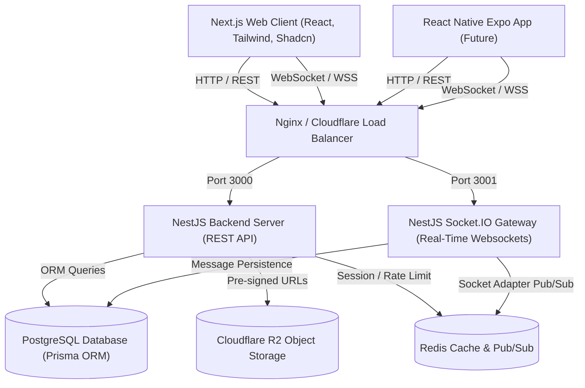
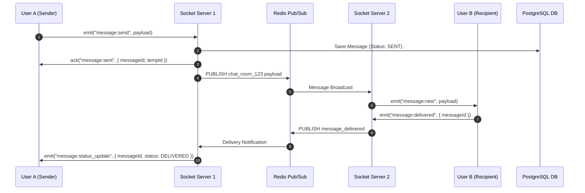
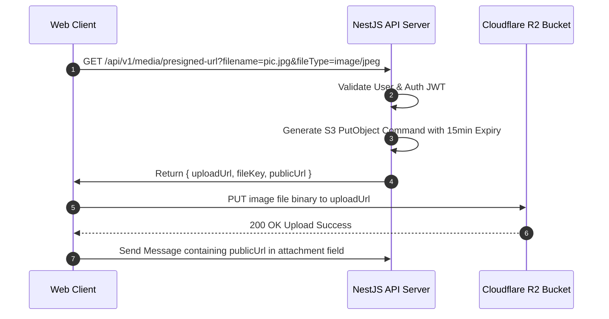

# NexChat — System Architecture Document

## 1. High-Level Architecture Overview

NexChat is built using a modern decoupled architecture that separates client presentation, backend API logic, real-time message broadcasting, caching, persistent storage, and object storage.



---

## 2. Component Breakdown & Responsibilities

### 2.1 Frontend (`apps/web` — Next.js 14+)
* **Framework**: Next.js App Router with TypeScript.
* **Styling**: Tailwind CSS, Shadcn UI components, Lucide Icons, Framer Motion for micro-animations.
* **State Management**:
  * **Zustand**: Global application state (active chat, current user, theme, open modals).
  * **TanStack Query (React Query)**: Server state management, paginated message history caching, user search.
* **Socket Integration**: Custom `useSocket` hook wrapper over `socket.io-client` with auto-reconnect, exponential backoff, and heartbeat monitoring.

### 2.2 Backend (`apps/server` — NestJS)
* **Framework**: NestJS modular architecture.
* **Modules**:
  * `AuthModule`: Signup, login, OAuth Google callback, refresh tokens, passport-jwt strategy.
  * `UserModule`: Profile updates, status management, username lookups.
  * `ChatModule`: Direct messaging room creation, message history queries, chat deletion.
  * `GroupModule` & `ChannelModule`: Group creation, member permissions, channel posts.
  * `MediaModule`: R2 SDK pre-signed PUT URL generation and mime validation.
  * `EventsModule` (`@WebSocketGateway`): Socket.IO event listener and emitter.

### 2.3 Data & Caching Layer
* **PostgreSQL (Primary DB)**: Stores structural data (users, chats, messages, reactions, permissions) via Prisma ORM.
* **Redis**:
  * **Pub/Sub Adapter**: Synchronizes WebSocket messages across horizontally scaled NestJS instances.
  * **Presence Cache**: Key-Value store (`user:online:{userId}`) with TTL heartbeats.
  * **Rate Limiting**: Stores API hit counters and socket event velocity.
* **Cloudflare R2**: AWS S3-compatible cloud object storage for low-cost, zero-egress multimedia file hosting.

---

## 3. Real-Time Communication Architecture

### 3.1 Socket.IO Adapter with Redis Pub/Sub
To support multiple Node.js instances, NestJS utilizes `@socket.io/redis-adapter`. When a message is sent to a server node, Redis publishes it across all server nodes, delivering it to the destination socket connection regardless of which server holds the client socket.



---

## 4. Media Upload Architecture (Cloudflare R2)

To ensure backend performance and minimize server payload overhead, multimedia files bypass the NestJS application server entirely during upload using AWS S3 / R2 Pre-signed URLs.



---

## 5. Directory Structure Overview (Monorepo Ready)

```
nexchat/
├── docs/                      # Planning & Architecture documentation
│   ├── PRD.md
│   ├── ARCHITECTURE.md
│   ├── DATABASE.md
│   ├── API.md
│   ├── UI_DESIGN.md
│   ├── SECURITY.md
│   └── IMPLEMENTATION_PLAN.md
├── apps/
│   ├── web/                   # Next.js 14+ Frontend Application
│   │   ├── src/
│   │   │   ├── app/           # App router pages
│   │   │   ├── components/    # UI components (chat, layout, shadcn)
│   │   │   ├── hooks/         # Custom hooks (useSocket, useAuth, useChat)
│   │   │   ├── lib/           # Socket client, API client, utils
│   │   │   └── store/         # Zustand global stores
│   └── server/                # NestJS Backend Application
│       ├── src/
│       │   ├── auth/          # JWT, OAuth, Passport strategies
│       │   ├── users/         # Profile & user services
│       │   ├── chats/         # Direct messaging & room services
│       │   ├── messages/      # Message CRUD & gateway handlers
│       │   ├── media/         # Cloudflare R2 presigned URL service
│       │   ├── prisma/        # Database context & Prisma service
│       │   └── gateway/       # Socket.IO Gateway & events
└── packages/                  # Shared types and configs (optional)
```
