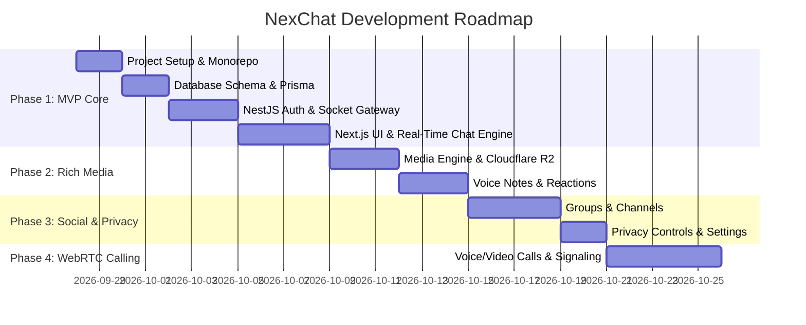

# NexChat — Detailed Implementation Plan & Roadmap

## 1. Development Phase Roadmap Overview

NexChat will be developed in structured, incremental phases. **Phase 1 defines the Minimum Viable Product (MVP)** required to deliver a complete, high-quality messaging application.

---

## 2. Phase 1 — MVP Detailed Breakdown (Execution Order)

The goal of Phase 1 is to establish a working, real-time messaging application shell with real authentication, online presence, direct messaging, persistent database storage, and a polished Telegram Web-inspired UI.

### Step 1: pnpm Monorepo & Project Structure
* Set up `pnpm-workspace.yaml` defining `apps/*` (`apps/web`, `apps/server`) and `packages/*` (`packages/shared`).
* Set up root `package.json`, `.gitignore`, root TypeScript configs, and `.env.example`.

### Step 2: NestJS Backend Setup (`apps/server`)
* Initialize NestJS application with TypeScript.
* Configure `@nestjs/config`, Passport JWT, and Argon2/bcrypt password hashing.
* Setup Prisma ORM context & schemas (`User`, `Profile`, `Session`, `Chat`, `ChatMember`, `Message`, `ReadReceipt`).
* Implement Auth REST APIs (`/auth/register`, `/auth/login`, `/auth/me`, `/auth/refresh`, `/auth/logout`).

### Step 3: Next.js Frontend Setup (`apps/web`)
* Initialize Next.js 14 App Router project with TypeScript and Tailwind CSS.
* Configure Shadcn UI component primitives and Lucide icons.
* Setup dark/light theme switching with Next-Themes and NexChat CSS design tokens.
* Build authentication UI pages (Login `/login`, Register `/register`) with interactive validation.
* Build responsive NexChat split-pane shell (Left chat sidebar + Active chat panel + Sliding user info drawer).

### Step 4: Database, Redis & Docker Compose Infrastructure
* Create `docker-compose.yml` configured for PostgreSQL 16 and Redis 7.
* Write database seed script to populate sample accounts for instant manual verification.

### Step 5: Shared Package & Type System (`packages/shared`)
* Create shared TypeScript DTO interfaces, enum definitions (`MessageType`, `ChatType`), and socket payload contracts shared between `apps/web` and `apps/server`.

### Step 6: Verification, Type Check & Linting
* Verify type safety across monorepo (`pnpm --recursive type-check` or `tsc --noEmit`).
* Verify build integrity (`pnpm build`).
* Validate end-to-end working authentication & profile display.

---

## 3. Phase 2 — Rich Media & Search
* Implement Cloudflare R2 pre-signed upload URL generation endpoint.
* File dropzone UI & media attachment preview (images, documents, videos).
* Inline voice note recorder with audio waveform preview.
* Message edit, delete (for everyone / for me), reply-to, and forward modals.
* Global search bar for user handles and chat content.

---

## 4. Phase 3 — Groups, Channels & Privacy
* Group creation wizard (public/private groups, admin assignments, invite link generation).
* Channel broadcast feed (subscriber mode, admin posts).
* User privacy settings page:
  * Last seen visibility rules (Everyone, Contacts, Nobody).
  * Read receipt toggle.
  * Blocked user management list.

---

## 5. Phase 4 — Voice/Video Calling & Push Notifications
* WebRTC peer-to-peer signaling over Socket.IO events (`call:offer`, `call:answer`, `call:ice_candidate`).
* Active call screen UI (video grid, microphone toggle, camera flip, screen share).
* Web Push notifications setup via Service Worker & FCM / Web Push protocol.

---

## 6. Phase 5 — React Native Mobile App (Future)
* Share TypeScript types, API client services, and socket hooks between web and mobile via monorepo packages.
* React Native Expo app setup with native navigation and mobile push notifications.

---

## 7. Verification & Definition of Done for MVP (Phase 1)
* [ ] User can successfully register, log in, receive a JWT token, and remain authenticated across page reloads.
* [ ] Authenticated user can search for another registered user by `@username`.
* [ ] Starting a chat creates a direct chat room and displays it in the sidebar.
* [ ] Sending a message updates the database and instantly delivers it to the recipient's screen in $<100\text{ ms}$.
* [ ] Typing in the message box broadcasts a live typing indicator to the recipient.
* [ ] Online/offline user status updates in real-time when users connect or disconnect sockets.
* [ ] Dark/Light mode theme toggle functions seamlessly without layout shifts.
* [ ] Interface is fully responsive on both desktop ($>1024\text{px}$) and mobile ($<768\text{px}$) viewports.
